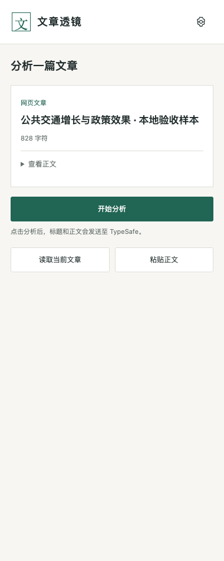
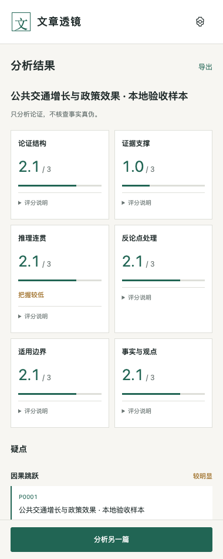
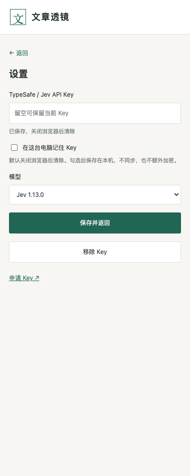

# 文章透镜 · Article Lens

[English](README.en.md)

用 Jev 分析文章的论证、证据和推理。支持普通网页、微信文字文章，也可以粘贴正文。

点击插件会读取当前文章；点击「开始分析」后，才会把标题和正文发送给 TypeSafe。界面使用中文，正文可以是其他语言。

## 能做什么

- 从六个方面评分：论证结构、证据支撑、推理连贯、反论点处理、适用边界、事实与观点。
- 提示四类疑点：以偏概全、因果跳跃、数字来源不明、情绪替代证据。
- 查看疑点对应的原文，导出 Markdown 报告。
- 长文分组分析，可取消，也可查看已完成的部分。

六项分别评分，不计算总分。插件不核查事实真伪；模型把握表示判断的确定程度，不代表文章可信度。

## 安装

需要 Chrome 116 或更新版本，无需构建或启动服务器。

1. 下载源码或安装 ZIP，解压到固定位置。
2. 打开 `chrome://extensions`，开启「开发者模式」。
3. 点击「加载已解压的扩展程序」。
4. 选择**直接包含 `manifest.json`** 的文件夹。
5. 在工具栏固定「文章透镜」。

不要直接把 ZIP 拖入 Chrome。升级时，替换原目录中的文件，再到扩展管理页点击重新加载。会话中保存的 Key 需要重新填写。若从新目录安装，请移除不用的旧版。

## 填写 Key

点击右上角的设置按钮，填入自己的 [TypeSafe/Jev Key](https://console.typesafe.ai/)，无需 `Bearer` 前缀。不需要其他模型的 Key。

默认只在当前浏览器会话中保存。勾选「在这台电脑记住 Key」后，Key 保存在扩展本地存储，不同步，也不额外加密。

「保存并返回」保存设置并回到文章，不会开始分析。「返回」放弃未保存的修改。「移除 Key」也会清除分析缓存。

## 使用

打开文章 → 点击插件 → 查看正文 → 开始分析。

结果页可以查看评分、疑点和原文，也可以导出报告。点击「分析另一篇」开始下一篇，Key、模型设置和会话缓存会保留。

读取失败时，重新读取或粘贴正文。普通网页也可选中正文后再次点击插件。网站有验证码时，需要先自行完成验证。

长文的每组评分只针对对应片段。部分分析失败时会显示已完成的组数，仍可导出；重新分析会从头开始，可能再次计费。

关闭后重开侧栏会恢复任务。再次点击工具栏会读取当前文章；分析还在进行时则恢复进度。

## 语言和限制

正文直接按原语言发送，不翻译；引用也保留原语言。Jev 官方说明英文表现最好，其他语言的准确率不同，见 [语言支持](https://docs.typesafe.ai/models#language-support)。

不识别图片文字，不转录视频，也不打开链接核实来源。正文需在 80～120,000 个字符之间；长文会分组，不截断。分组规则和展示阈值见 [设计文档](docs/design.md)。

## 隐私和用量

- 正文在本机读取，点击分析后才发送至 TypeSafe API。
- Key 只由扩展后台放入请求头，不进入正文、采集脚本或导出报告。
- 不读取 Cookie 或浏览历史，不在所有网页上自动运行。
- 当前文章和最近五份分析缓存保存在浏览器会话中。
- 分析使用你的 TypeSafe 账户用量。服务限流或繁忙时最多重试一次；其他错误和超时不自动重试。
- 取消本地分析后，已经发出的请求仍可能被处理和计费。

服务端如何处理数据，以 [TypeSafe 隐私政策](https://typesafe.ai/legal/privacy-policy)及账户条款为准。

## 开发

开发检查需要 Node.js 22+，打包需要 Python 3.10+。插件本身无需这些工具。

```sh
npm ci
npm test
npx playwright install chromium
npm run test:e2e
npm run package
npm run test:package
```

Linux 上安装浏览器和系统依赖：`npx playwright install --with-deps chromium`。

浏览器测试使用临时 Chrome 配置、本地文章和模拟 Jev 响应，不使用真实 Key。测试结果保存在 `test-results/`，安装包保存在 `dist/`。

## 文档和许可

- [设计文档](docs/design.md)：页面流程、功能框架和实现架构。
- [验证记录](docs/verification.md)：检查结果与未验证的范围。
- [第三方声明](THIRD_PARTY_NOTICES.md)。

项目采用 MIT 许可；Mozilla Readability 采用 Apache 2.0 许可。产品思路参考 [cadeos/jev-grounds](https://github.com/cadeos/jev-grounds)。本项目与 TypeSafe、Grounds 无隶属关系。

## 界面

截图使用本地测试文章和模拟响应，不是真实文章的评分。

|开始页|结果页|设置页|
|---|---|---|
||||
