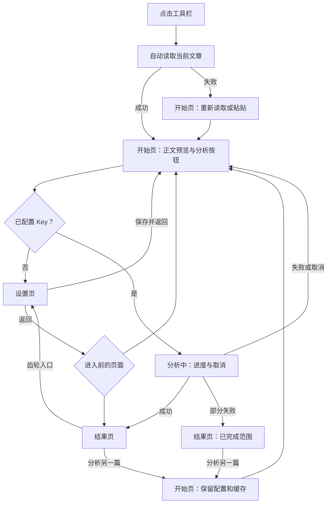
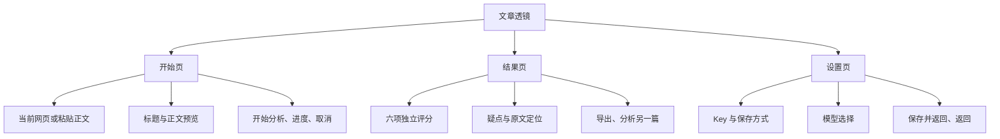
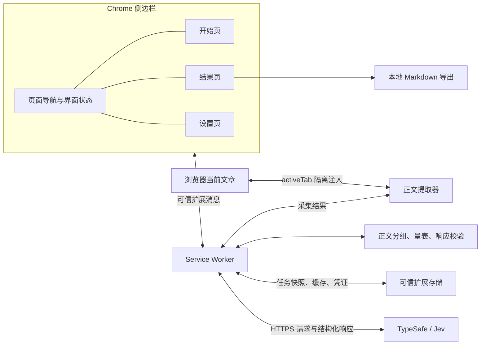

# 文章透镜 v1.1 设计与实现

通用文章分析工具：当前页或手动粘贴 → 本机预览 → 用户发送 → 查看分析 → 分析另一篇。界面中文，文本输入支持多语言；没有语言翻译或事实核查步骤。

## 用户流程图

## 页面与功能框架图

## 实现架构图

## 状态、导航和消息

- 原生 HTML/CSS/JavaScript，Manifest V3，侧边栏内三个独立视图。网页内容脚本只在点击读取时按 activeTab 注入，无全站常驻脚本。
- `ui/navigation.js` 管理 start/result/settings、返回页及滚动位置。任务状态由后台管理，界面关闭不等于取消任务。
- 完成任务进入结果页；失败但有已完成分组也进入结果页；分析中即使已有分组也仅显示进度。
- 设置页不被普通后台刷新抢占。保存后回到任务对应页面，返回清空密码草稿。设置往返保留正文、结果及粘贴草稿。
- `newArticle` 清空当前任务，保留凭证、偏好和缓存；`clear` 清除正文及会话缓存。`saveKey`、`forgetKey` 管理凭证；`read/paste/analyze/cancel/focus/getState` 延续原接口。
- 消息接受方只信任浏览器提供的扩展 ID 和精确面板 URL。Key 不会从 getState 返回，网页采集器没有存储及网络访问。
- 任务身份与读取版本避免取消后旧请求覆盖新状态。每组完成即保存结果；后台重启将进行中的任务标为中断，保留已有正文与分组。

## 评分和错误处理

六项 Score 分别评分，保持现有量表；argument 的中文展示名为「论证结构」。没有平均、加权总分或语言质量校准。评分说明中显示模型把握；低于 0.65 标记。

四类疑点使用 Noul，原文位置使用 Choice。概率 ≥ 0.8 优先显示；0.2～0.8 不确定项折叠且可展开。候选位置不可靠时明确提示，不能伪造原文。

正文状态预算为 21,000 UTF-8 字节，每组至多 180 个单元；文本不静默截断。片段结果不能作为全文综合分。部分失败可导出已有结果；重新分析从头请求并明确提示用量。

仅请求固定 TypeSafe HTTPS 地址，禁止重定向、不发送 Cookie。24 秒超时；429/529 最多重试一次；其他错误不自动重试。取消不保证服务端停止或不计费。

## 视觉与范围

沿用纸白、深绿与暖色提示。输入、分析、设置分开；没有流程编号、时间、tokens 和重复长段说明。评分同级，细节折叠，原文按需打开。

微信优先读取已加载可见的正文区域；普通网页使用 Readability，失败时可使用用户选中文本或粘贴。验证、删除和纯图片情况不会用整页文本替代。不做 OCR、视频转录、外部来源核实或账户系统。

## 验证与交付

单元测试验证请求、响应、消息、缓存、取消、部分结果恢复及导航；浏览器测试使用本地样本、模拟 API 和临时 Chrome 配置，验证实际扩展运行与界面。多语言样本证明输入链路可用，不证明评分准确率。

仓库与安装 ZIP 根目录包含 manifest。安装包以白名单打包，排除测试配置、凭证、开发依赖和历史验证产物。CI 不使用真实 Key。源码在 GitHub 管理，打包脚本只生成安装包。
